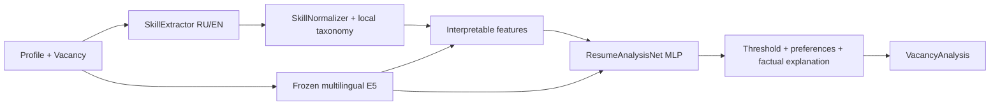

# ResumeAnalysis

Локальная ML-подсистема ApplyPilot для сопоставления компетенций кандидата и вакансии.

`predict(profile, vacancy) -> VacancyAnalysis` использует собственную обучаемую
PyTorch MLP и замороженный `intfloat/multilingual-e5-small`. Inference работает
на CPU без сетевых запросов. Название вакансии не превращается в навыки: сопоставляются
текст, явные списки компетенций, опыт и квалификация. Нет генеративных API,
frontend, Kafka, обязательной БД, Neo4j или GPU.

Это исследовательский MVP: голова обучена на загруженных синтетических данных.
Словарный extractor поддерживает RU/EN для ограниченного набора компетенций;
полноценный NER пока не обучен. Подробности исходников и лицензий —
[исследование](docs/research.md), [уведомления](THIRD_PARTY_NOTICES.md).

## Установка на Arch Linux

Пакет требует Python 3.11+. Проверен в Linux x86_64 / Python 3.12 на CPU;
отдельный запуск на Arch Linux и Ryzen 7 5700U не выполнялся.
Рекомендуемый воспроизводимый путь:

```bash
sudo pacman -S --needed git uv
git clone https://github.com/nyaxiom/resumeanalysis.git
cd resumeanalysis
uv python install 3.12
uv sync --python 3.12 --frozen --extra dev --extra data
source .venv/bin/activate
```

`uv.lock` фиксирует зависимости с checksum; torch берётся из CPU index PyTorch.
На других Linux нужны Git, uv и Python 3.11/3.12. Для refresh используйте тот же
`uv sync --frozen`; системный Python менять не нужно.

## Воспроизвести выполненный эксперимент

Все команды ниже запускаются из корня checkout с активированной `.venv`:

```bash
resumeanalysis download-e5 --output artifacts/e5
resumeanalysis download-data --output data/raw/candidate-matching-synthetic
resumeanalysis prepare --max-jobs 250 --pairs-per-job 2 --seed 42
resumeanalysis train --config configs/cpu.json
resumeanalysis evaluate
HF_HUB_OFFLINE=1 TRANSFORMERS_OFFLINE=1 \
  resumeanalysis predict --input examples/pair.json
```

Первая команда скачивает около 470 MB safetensors E5 и tokenizer, проверяет MIT
model card и SHA256 весов. Вторая скачивает три небольших parquet (10 000 profiles,
2 500 jobs, 2 500 positive lists), проверяет MIT и checksum.
Обе закреплены на конкретных upstream revisions в `data/download.py`,
сохраняют README и provenance manifests. Для загрузки нужны HTTPS-домены
`huggingface.co` и текущий redirect-host `us.aws.cdn.hf.co` (возможны Xet/CDN hosts).
На этапе inference сеть не нужна; `local_files_only=True`, `trust_remote_code=False`.

Обязательны install, скачивание E5, prepare, train и проверка inference.
SkillSpan — отдельная проверка extraction; полный NER train и большой fit benchmark
не входят в выполненный smoke-эксперимент.

Выходы (в Git не включаются):

| Путь | Содержимое |
|---|---|
| `data/raw/.../manifest.json` | Source revision, лицензия, SHA256 загруженных файлов |
| `data/processed/{train,validation,test}.jsonl` | Строго разделённые пары с provenance |
| `data/processed/manifest.json` | Counts, seed, hashes, negative policy, leakage check |
| `artifacts/e5/` | Проверенные локальные frozen weights и tokenizer |
| `artifacts/embeddings/`, `artifacts/feature_cache/` | Кеши текста/признаков, зависящие от версий pipeline |
| `artifacts/run/model.pt` | Обученная MLP, конфигурация, порог и encoder/taxonomy identity |
| `artifacts/run/logistic.npz` | Числовые веса и scaler Logistic Regression |
| `artifacts/run/metrics.json` | Метрики, история обучения, hashes splits |
| `artifacts/run/errors_*.json` | Ошибки по IDs и признакам, без полного текста резюме |

Не удаляйте embeddings cache между запусками головы: encoder не переобучается.
Кеш содержит производные профилей; храните его как локальные данные приложения.

## Архитектура



* **SkillExtractor**: слова/границы, spans, explicit negation и планы обучения,
  required/optional sections, годы и seniority по правилам. Из title навыки
  не извлекаются. Свободное описание без явного requirement marker не объявляется
  обязательным набором: его навыки учитываются отдельным признаком `mentioned_match`.
* **SkillNormalizer**: Postgres → postgresql, GNU/Linux → linux, Python 3 → python.
  Torch → pytorch только с однозначным Python/tensor context. Частичные связи
  PostgreSQL → SQL и Kubernetes → Docker не означают подтверждения целевого навыка.
  Четыре verified ESCO concept URI, импорт официального skills CSV без Neo4j.
* **TextEncoder**: E5 `query:` для профиля, `passage:` для вакансии, максимум 512 токенов
  вместе с prefix/special tokens, overlap 32, masked mean pooling, weighted chunk
  pooling и L2-normalization. Cache key включает model revision, роль, текст и chunk config.
* **FeatureEngineering**: 17 интерпретируемых числовых признаков; полный перечень и порядок
  в `FEATURE_NAMES`. Покрытие required/optional разделено на confirmed / unknown / denied,
  семантика, частичная поддержка связями, опыт и известность опыта, разрыв, seniority,
  размеры наборов, совпадение прочих упоминаний и наличие explicit requirements.
* **ResumeAnalysisNet**: `[r, j, abs(r-j), r*j, features]`, 1 553 входа при E5 384,
  Linear(128) → GELU → Dropout → Linear(32) → GELU → Dropout → один логит.
  BCEWithLogitsLoss, AdamW, class weighting, gradient clipping, validation loss,
  early stopping и восстановление лучшей эпохи. Все гиперпараметры в `configs/cpu.json`.
* **Postprocessor**: sigmoid score и порог, проверка жёстких предпочтений, matched/
  unknown/contradicted skills и шаблонное объяснение. Генеративной LLM нет.

`relevance` — некалиброванная оценка [0,1]. `missing_skills` — совместимый список
неподтверждённых **и** явно отрицаемых навыков. Для различения используйте
`unknown_skills` и `contradicted_skills`: отсутствие упоминания не доказывает отсутствие
навыка. Конфликтующие положительные/отрицательные сведения считаются неизвестностью.
Неизвестный опыт остаётся `None`, а не 0. Неподтверждённое жёсткое предпочтение
(например, `remote_only=True`, `remote=None`) даёт `relevant=False` с объяснением;
исходная оценка модели сохраняется.

## Интеграция с ApplyPilot

После стандартного обучения функция работает из корня проекта:

```python
import json
from resumeanalysis import predict

pair = json.load(open("examples/pair.json", encoding="utf-8"))
analysis = predict(pair["profile"], pair["vacancy"])
payload = analysis.model_dump()  # JSON-совместимый ответ backend
```

В долгоживущем backend создавайте один predictor при старте процесса:

```python
from resumeanalysis import Predictor
from resumeanalysis.embeddings.encoder import TextEncoder

predictor = Predictor("artifacts/run/model.pt", TextEncoder("artifacts/e5"))
analysis = predictor.predict(
    {"resume_text": "Python и SQL", "experience_years": 2, "remote_only": True},
    {"title": "ML Engineer", "description": "Required: Python and SQL.", "remote": True},
)
print(analysis.model_dump_json())
```

`RESUMEANALYSIS_CHECKPOINT` и `RESUMEANALYSIS_E5_PATH` меняют пути default predictor;
установите их до первого вызова `predict()`. В CLI есть `--checkpoint`, `--e5-path`.
Отсутствующие веса или несовместимые encoder/taxonomy/schema приводят к ошибке,
автоматической подмены нейросети эвристикой нет. `summary`, `resume_id`, `cover_letter`
всегда `null` и зарезервированы для будущей совместимости.

## Обучение на большей выборке и собственных парах

Пример расширенного запуска (не выполнялся в этом PR):

```bash
resumeanalysis prepare --max-jobs 2500 --pairs-per-job 10 --output data/full
resumeanalysis train --data data/full --output artifacts/full --config configs/cpu.json
resumeanalysis evaluate --data data/full --output artifacts/full
resumeanalysis predict --checkpoint artifacts/full/model.pt --input examples/pair.json
```

Количество реально полученных пар зависит от entity-disjoint partitions и positive pools.
Сначала создайте кеш эмбеддингов, затем меняйте гиперпараметры головы; `train`
автоматически переиспользует валидные кеши. Начните с 2 CPU threads и batch 64,
на небольшом CPU уменьшайте `hidden_dims` и batch. Скорость на Ryzen 5700U не измерялась.

Для собственных данных используйте `PairRecord` в `data/dataset.py` и `grouped_split()`:
`candidate_id`, `vacancy_id`, `profile`, `vacancy`, бинарная `label`, `provenance`,
`hard_negative`. `save_splits()` создаёт JSONL и manifest. Обязательны независимые
кандидаты **и** вакансии, обе метки в каждом split, provenance разметки и права на данные.
Порог подбирается по validation Macro-F1; test не используется в training/early stopping.
Rule-based baseline и Logistic Regression обучаются/оцениваются в том же запуске;
LR и MLP получают одинаковый набор векторов и признаков, scaler обучается только на train.
Rule-based baseline имеет фиксированную формулу, его порог также выбирается по validation.

`prepare-med2425` реализован отдельно из-за трёхклассовой схемы. Upstream лицензия
не указана, поэтому payload не скачан и результаты на нём не заявляются. После
получения подходящих прав требуется manifest с `license` и `source_license_urls`:

```bash
resumeanalysis prepare-med2425 --input /path/to/licensed.parquet \
  --output data/licensed-fit --license-evidence /path/to/reviewed-license.json \
  --potential-fit exclude
```

Для изменения ESCO taxonomy импортируйте официальный CSV через
`Taxonomy.import_esco()`, передайте `SkillNormalizer(taxonomy)` в `SkillExtractor`
и `FeatureEngineering`. Изменение словаря/правил требует пересчёта признаков,
увеличения `PIPELINE_VERSION` при изменении логики и переобучения головы.
Python API `train(..., extractor=extractor)`, `Predictor(..., extractor=extractor)`
и `evaluate_saved(..., extractor=extractor)` позволяют передать один и тот же словарь.
Текущий CLI использует seed taxonomy. Несовместимая taxonomy при inference
отклоняется, готовые веса не переносятся на другой словарь молча.

## Проверки и результаты

```bash
pytest -q
RESUMEANALYSIS_RUN_E5_TESTS=1 pytest -q
ruff check .
ruff format --check .
uv build
```

Обычный pytest не скачивает модели: тестирует правила, нормализацию, split/leakage,
адаптеры и train/save/reload на текстовых fixtures. E5 chunking/prefix/pooling/cache
проверяется настоящим маленьким локальным transformer из тестового fixture.
Opt-in дополнительно проверяет скачанный pretrained multilingual E5, RU/EN и длинный текст.
Тестовые random weights не используются для опубликованных fit-метрик.

Фактический CPU smoke: 696 train / 150 validation / 148 test, seed 42,
лучший checkpoint на эпохе 63, остановка после 73 эпох. Замороженный E5,
обучались MLP и Logistic Regression. Precision/recall для класса relevant;
confusion matrix имеет строки true `[0,1]`, столбцы predicted `[0,1]`.

| Подход | Precision | Recall | Macro-F1 | ROC-AUC | Confusion matrix |
|---|---:|---:|---:|---:|---|
| Rule-based | 0.9024 | 1.0000 | 0.9458 | 0.9956 | `[[66,8],[0,74]]` |
| Logistic Regression | 0.8625 | 0.9324 | 0.8917 | 0.9680 | `[[63,11],[5,69]]` |
| ResumeAnalysisNet | 0.9733 | 0.9865 | 0.9797 | 0.9996 | `[[72,2],[1,73]]` |

На этой выборке MLP улучшила Macro-F1 относительно обоих baseline. Это небольшой,
исследовательский синтетический эксперимент с rule-derived negatives, **не**
доказательство преимущества на реальных данных или калиброванности score.
Полные метрики, hashes и анализ ошибок — [docs/evaluation.md](docs/evaluation.md).

Проверка SkillSpan (внешний временный clone, данные в Git не добавляются):

```bash
git clone https://github.com/kris927b/SkillSpan /tmp/SkillSpan
git -C /tmp/SkillSpan checkout 2ccf3de5b5af7a5409b8dd814fb1315dd6e0ae1b
resumeanalysis skillspan --input /tmp/SkillSpan/data/json/test.json
```

На всех 3 569 test-предложениях exact-span F1 = **0.1460**, recall = **0.0830**.
Словарь распознаёт некоторые технологии, но пропускает большинство свободных
профессиональных навыков; нельзя выдавать его за полноценный NER Nesta.
Русский язык проверен правилами и E5, количественный RU NER benchmark отсутствует.

## Следующие задачи

1. Обучить/подключить полноценный локальный NER и проверить на независимом RU/EN корпусе.
2. Получить лицензированные fit labels, разметку работодателей и near-duplicate audit.
3. Проверить независимые seed/splits, доверительные интервалы, калибровку и рабочие пороги.
4. Улучшить scope отрицаний и извлечение длительности/диапазонов опыта: текущие regex
   не заменяют разбор карьеры и не суммируют employment dates.
5. Проверить latency/RAM на Ryzen 5700U, при необходимости измерить quantization.

Веса, датасеты и кеши остаются локальными. Снимок облачного окружения и публикация
PR не заменяют отдельную проверку восстановления в новой задаче.
