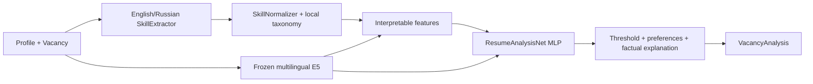

# ResumeAnalysis

An opt-in [Retrieve → Re-rank backend](docs/retrieve_rerank.md) adds multilingual
E5 retrieval, a pinned multilingual cross-encoder and explicit requirement checks.
It supports `create_predictor("rerank")`, single-pair predictions and batch
ranking. See [actual benchmark results](docs/rerank_benchmarks.md) and the
[independent evaluation protocol](evaluation/README.md); document relevance
scores are not calibrated hiring probabilities. E5 + MLP remains the default.

Skill extraction has a selectable [v2 implementation and comparison workflow](docs/skill_extractor_v2.md).
The original extractor remains the default. Using v2 with the MLP requires a matching
separately trained checkpoint; the original saved model is preserved. See the
[measured validation](docs/skill_extractor_validation.md) for precision/recall,
CPU costs, split-overlap findings and downstream limitations.

An optional local Qwen Instruct backend and strict dataset adapters are available
on this feature branch. See [Qwen setup and experiments](docs/qwen.md) and
[loss-aware dataset conversion](docs/dataset_adapters.md). The E5 + MLP workflow
below remains the default.
See the [implementation and validation record](docs/qwen_validation.md) for safeguards,
executed checks and remaining limitations.

A local ML subsystem for ApplyPilot that matches a candidate's competencies to a vacancy.

`predict(profile, vacancy) -> VacancyAnalysis` uses a trainable PyTorch MLP and frozen
`intfloat/multilingual-e5-small` embeddings. Inference runs locally on CPU without
external API calls. Job titles do not become assumed skills: matching uses evidence
in the text, explicit skills, experience and seniority.

The project is a research MVP trained on downloaded synthetic data. Its English/Russian
skill extractor uses a finite dictionary and rules; a full NER model has not been trained.
See [research](docs/research.md), [evaluation](docs/evaluation.md), and the
[license audit](docs/license_audit.md) for evidence and limitations.

## Installation

Python 3.11+ is required. The development environment has been tested on Linux with
Python 3.12; CI also checks Python 3.11. Arch Linux installation:

```bash
sudo pacman -S --needed git uv
git clone https://github.com/nyaxiom/resumeanalysis.git
cd resumeanalysis
uv python install 3.12
uv sync --python 3.12 --frozen --extra dev --extra data
source .venv/bin/activate
```

On other Linux distributions, install Git and uv, then use the same Python and uv commands.
`uv.lock` fixes dependencies and artifact checksums. PyTorch comes from its CPU index.
Use `uv sync --frozen` to refresh the environment without changing the lockfile.

## Reproduce the completed experiment

Run these commands from the checkout root with the virtual environment activated:

```bash
resumeanalysis download-e5 --output artifacts/e5
resumeanalysis download-data --output data/raw/candidate-matching-synthetic
resumeanalysis prepare --max-jobs 250 --pairs-per-job 2 --seed 42
resumeanalysis train --config configs/cpu.json
resumeanalysis evaluate
HF_HUB_OFFLINE=1 TRANSFORMERS_OFFLINE=1 \
  resumeanalysis predict --input examples/pair.json
```

The E5 download retrieves the pinned safetensors weights and tokenizer, checks the
model card's MIT declaration, and verifies the weights' SHA256. The dataset command
retrieves three pinned parquet tables, checks the dataset card's MIT declaration,
and verifies checksums. Both retain upstream cards and provenance manifests.
A card's declaration does not resolve every upstream-rights question: see the license audit.

Downloads require HTTPS access to `huggingface.co` and its redirect/CDN destinations,
currently including `us.aws.cdn.hf.co`. Inference uses `local_files_only=True` and
`trust_remote_code=False`; it does not need network access.

Installation, E5 download, data preparation, training and functional inference are
required to reproduce the workflow. SkillSpan is a separate extraction evaluation.
Full-data training and full NER training have not been performed.

Generated files are excluded from Git:

| Path | Contents |
|---|---|
| `data/raw/.../manifest.json` | Source revision, declared license and downloaded-file hashes |
| `data/processed/{train,validation,test}.jsonl` | Entity-disjoint pairs with label provenance |
| `data/processed/manifest.json` | Counts, seed, hashes, negative policy and leakage check |
| `artifacts/e5/` | Local frozen weights, tokenizer and model manifest |
| `artifacts/embeddings/`, `artifacts/feature_cache/` | Versioned embedding and feature caches |
| `artifacts/run/model.pt` | Trained MLP, configuration, threshold and pipeline identities |
| `artifacts/run/logistic.npz` | Numeric Logistic Regression coefficients and scaler |
| `artifacts/run/metrics.json` | Metrics, training history and split hashes |
| `artifacts/run/errors_*.json` | Error IDs, scores and features, without full resume texts |

Keep valid embedding caches between head-training runs; the encoder is frozen.
Caches contain data derived from profiles and should be handled as local application data.

## Architecture



* **SkillExtractor** finds bounded skill mentions and spans, explicit negation,
  learning plans, required/optional sections, years and seniority using rules.
  It does not extract skills from the vacancy's title field. Unclassified mentions
  remain separate from explicit mandatory requirements.
* **SkillNormalizer** maps aliases such as Postgres to postgresql, GNU/Linux to linux,
  and Python 3 to python. Torch maps to pytorch only with clear Python/tensor context.
  Directional relationships such as PostgreSQL to SQL provide partial support,
  not confirmation that the candidate possesses the related skill. Four ESCO concept
  identifiers and an official skills-CSV importer are included; Neo4j is not required.
* **TextEncoder** uses E5 `query:` for profiles and `passage:` for vacancies.
  Token-aware chunks include prefixes and special tokens within the 512-token limit,
  with overlap, masked mean pooling, weighted chunk aggregation and L2 normalization.
  Cache identity includes revision, role, text and chunk configuration.
* **FeatureEngineering** exposes 17 numeric features in `FEATURE_NAMES`:
  required/optional confirmed, unknown and denied ratios; semantic similarity;
  related-skill support; experience match, knownness and gap; seniority match and
  knownness; skill-set sizes; other mentioned-skill coverage; and known requirements.
* **ResumeAnalysisNet** consumes `[r, j, abs(r-j), r*j, features]`: 1,553 inputs with
  E5, two hidden layers, GELU, Dropout and one logit. Training uses BCEWithLogitsLoss,
  AdamW, class weighting, gradient clipping, validation loss, early stopping and
  restoration of the best checkpoint. Hyperparameters are in `configs/cpu.json`.
* **Postprocessor** applies a threshold and hard preferences, lists matched, unknown
  and contradicted skills, and produces English factual explanations. It uses no
  generative model.

`relevance` is an uncalibrated score in [0,1]. The compatibility field `missing_skills`
combines unknown and explicitly denied skills; inspect `unknown_skills` and
`contradicted_skills` to distinguish them. Lack of a mention is not proof of inability.
Conflicting positive/negative evidence becomes unknown. Unknown experience stays
`None`, not zero. Unconfirmed hard preferences, such as remote-only with an unknown
vacancy work arrangement, produce `relevant=False` with an explanation while preserving
the model's score.

Russian aliases, extraction patterns and multilingual test inputs remain intentional
language data. Documentation, ordinary examples and user-facing output are English.

## ApplyPilot integration

After the standard training command, use the public interface from the checkout root:

```python
import json
from resumeanalysis import predict

with open("examples/pair.json", encoding="utf-8") as stream:
    pair = json.load(stream)
analysis = predict(pair["profile"], pair["vacancy"])
payload = analysis.model_dump()
```

In a long-lived backend, initialize one predictor when the process starts:

```python
from resumeanalysis import Predictor
from resumeanalysis.embeddings.encoder import TextEncoder

predictor = Predictor("artifacts/run/model.pt", TextEncoder("artifacts/e5"))
analysis = predictor.predict(
    {"resume_text": "Python and SQL", "experience_years": 2, "remote_only": True},
    {"title": "ML Engineer", "description": "Required: Python and SQL.", "remote": True},
)
print(analysis.model_dump_json())
```

Set `RESUMEANALYSIS_CHECKPOINT` and `RESUMEANALYSIS_E5_PATH` before the first public
`predict()` call to override its paths. The CLI also has `--checkpoint` and `--e5-path`.
Missing weights or incompatible encoder/taxonomy/schema identities fail explicitly;
the neural model is not silently replaced by a heuristic. `summary`, `resume_id`
and `cover_letter` are reserved and always null.

## Larger experiments and custom data

Example larger run, not executed for the reported results:

```bash
resumeanalysis prepare --max-jobs 2500 --pairs-per-job 10 --output data/full
resumeanalysis train --data data/full --output artifacts/full --config configs/cpu.json
resumeanalysis evaluate --data data/full --output artifacts/full
resumeanalysis predict --checkpoint artifacts/full/model.pt --input examples/pair.json
```

Actual pair counts depend on entity partitions and available positive pools.
`train` automatically reuses valid embedding/feature caches when tuning the head.
Configure concurrency, batch size and hidden dimensions in `configs/cpu.json`.

For your own data, use `PairRecord` and `grouped_split()` in `data/dataset.py`:
`candidate_id`, `vacancy_id`, `profile`, `vacancy`, binary `label`, `provenance`,
and `hard_negative`. `save_splits()` writes JSONL and a manifest. Both candidates
and vacancies must be independent across splits, and each split must contain both classes.
Document rights and label provenance before using a dataset.

Thresholds are selected by validation Macro-F1. Test data is not used for training
or early stopping. Rule-based and Logistic Regression baselines run on the same splits;
LR and MLP receive the same representation, and the scaler is fitted only on train.
The rule baseline uses a fixed formula with a validation-selected threshold.

`prepare-med2425` handles its distinct three-class schema. The upstream card has no
license declaration, so its payload has not been downloaded or used. After obtaining
suitable rights, provide reviewed evidence containing `license` and `source_license_urls`:

```bash
resumeanalysis prepare-med2425 --input /path/to/licensed.parquet \
  --output data/licensed-fit --license-evidence /path/to/reviewed-license.json \
  --potential-fit exclude
```

The manifest-field check is not legal validation. The license audit records unresolved
rights in that dataset and its merged inputs.

For a custom taxonomy, import an official CSV with `Taxonomy.import_esco()`, then pass
`SkillNormalizer(taxonomy)` to `SkillExtractor`. The Python APIs `train`, `Predictor`
and `evaluate_saved` accept `extractor=extractor`; use the same extractor throughout.
Changing rules requires feature recomputation, a `PIPELINE_VERSION` update when logic
changes, and retraining. The CLI uses the seed taxonomy. Incompatible checkpoints
are rejected rather than silently reused.

## Validation and results

```bash
pytest -q
RESUMEANALYSIS_RUN_E5_TESTS=1 pytest -q
ruff check .
ruff format --check .
uv build
```

The default suite requires no model downloads. It tests rules, normalization,
adapters, leakage prevention, training and save/reload on authored text fixtures.
A tiny local transformer tests prefix/chunk/pooling/cache mechanics; its random
weights are not used for published fit metrics. The opt-in test additionally checks
the downloaded pretrained E5 on multilingual and long texts.

Completed experiment: 696 train / 150 validation / 148 test pairs, seed 42,
best MLP checkpoint at epoch 63, early stopping after epoch 73. Only MLP and LR
were trained; E5 stayed frozen. Precision/recall below are for the positive class.
Confusion matrices use true rows and predicted columns, ordered `[0,1]`.

| Method | Precision | Recall | Macro-F1 | ROC-AUC | Confusion matrix |
|---|---:|---:|---:|---:|---|
| Rule-based | 0.9024 | 1.0000 | 0.9458 | 0.9956 | `[[66,8],[0,74]]` |
| Logistic Regression | 0.8625 | 0.9324 | 0.8917 | 0.9680 | `[[63,11],[5,69]]` |
| ResumeAnalysisNet | 0.9733 | 0.9865 | 0.9797 | 0.9996 | `[[72,2],[1,73]]` |

The MLP improved Macro-F1 on this small exploratory synthetic sample. This does not
establish performance on real hiring decisions or score calibration. Full results,
hashes and error analysis are in [docs/evaluation.md](docs/evaluation.md).

The historical legacy evaluation across all 3,569 SkillSpan test sentences
reported exact-span F1 **0.1460**, recall **0.0830**.
The dictionary recognizes some technologies but misses most open-ended professional
competencies. It is not a replacement for Nesta's full NER. Russian extraction has
unit coverage, but no quantitative Russian NER benchmark has been run.

For new dataset preparation and model selection, use the
[Skill Extractor data foundation](docs/skill_data/README.md). It provides eight
pinned dataset sources, immutable downloads, separate annotation schemas,
duplicate/leakage auditing and train-only vocabulary experiments. The original
SkillSpan test is now frozen; the new workflow uses its text fingerprints only
to quarantine contamination and never ingests or scores its annotations.

On the audited SkillSpan validation subset, V2 full-alias coverage is **12.69%**.
Expanding its dictionary from real training spans raises recall but lowers F1;
see [the measured findings](docs/skill_data/findings.md) and
[controlled NER experiment plan](docs/skill_data/training_strategy.md).

## Next work

1. Train or integrate a full local NER and evaluate on independent English/Russian data.
2. Obtain licensed fit labels and employer annotations; audit near-duplicates.
3. Evaluate independent seeds/splits, confidence intervals, calibration and thresholds.
4. Improve negation scope and experience-range parsing; regex does not reconstruct a career.
5. Benchmark inference and investigate quantization if measurements justify it.

## Licensing

Original ResumeAnalysis code is MIT. Third-party components retain their own terms.
Read [THIRD_PARTY_NOTICES.md](THIRD_PARTY_NOTICES.md) and
[the compliance audit](docs/license_audit.md) before distributing software bundles,
model weights, data or a complete environment. Model/data MIT card declarations,
ESCO version-specific terms, native runtime obligations and unlicensed med2425 inputs
have unresolved review items. License notices are included in built distributions.
