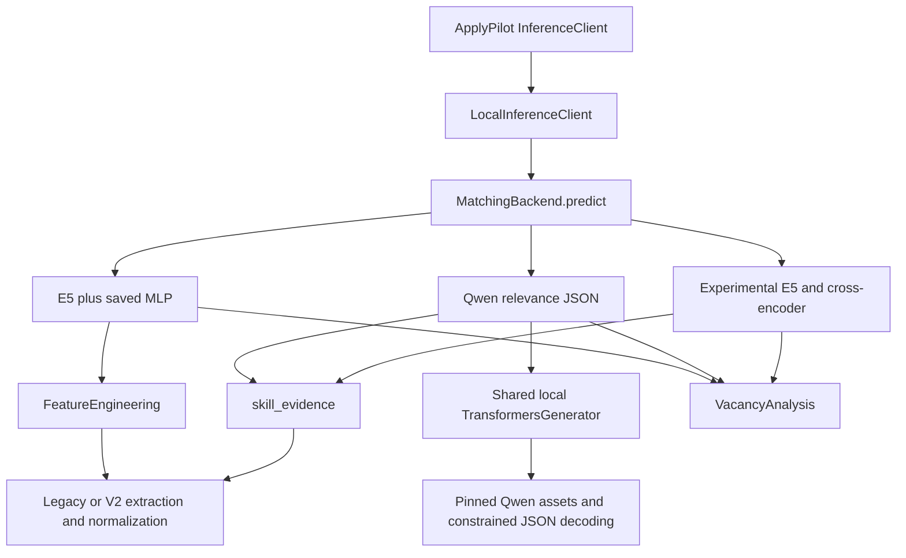

# Cover-letter architecture and source audit

Source inspection date: 2026-10-26. Exact revisions, source URLs and SHA-256
digests are retained in [source evidence](cover_letter_source_evidence.json).
This audit inspected implementation files, prompt builders, provider routing and
tests. Upstream applications were not installed or given candidate data.

## Existing repository

The latest inspected remote main is `a9632b2cd4b1077d5e88ec4fd126bd04dc694ea1`.
Its tree equals data-foundation `de5e6a8`; the user had merged PRs #3 and #6.
The inspected feature branches are Qwen `ad45d07`, extractor V2 `dc2a670`,
data foundation `de5e6a8`, and completed reranking `573e8d0` (draft PR #7).
PRs #4 and #5 remain open. No branch contains a working cover-letter generator:
`VacancyAnalysis.cover_letter`, `summary` and `resume_id` were None-only slots.
There is therefore **no previous cover-letter quality baseline to measure**.

The saved relevance model is a trained MLP over frozen multilingual E5 embeddings
and structured features. The Qwen backend generates a constrained relevance
decision; it does not write letters. Its configured model is Qwen2.5-7B-Instruct.
The newer opt-in backend uses multilingual E5 plus an mMARCO cross-encoder and
explicit evidence checks. All share project schemas/normalization and preserve
the legacy default. Model identity guards prevent substituting an extractor into
an incompatible MLP checkpoint.

Deletion assessment:

| Component | Dependencies and decision |
|---|---|
| `qwen/runtime.py`, download/config utilities | Reused for local letter generation; still used by Qwen relevance. Keep. |
| `qwen/predictor.py`, prompts and structured decoding | Implement relevance, a separate task. Keep, including optional `lm-format-enforcer`. |
| E5, MLP, feature builder, postprocessing and checkpoints | Existing relevance and evaluation consumers. Keep unchanged. |
| Legacy and V2 extractors/normalizer | Used by relevance and bounded output screening. Keep; no measured basis for removing them. |
| Existing cover-letter implementation/configuration | None exists. No fictitious obsolete generator or dependencies are deleted. |
| UI/database/PDF/provider stacks in candidate repositories | Not imported; no dependency cleanup is needed for packages never introduced. |

## Six candidate implementations

| Project | Actual generation and input handling | Local/Qwen and languages | Tests and factual safeguards | License and extraction cost |
|---|---|---|---|---|
| [0xrsydn/coverletter](https://github.com/0xrsydn/coverletter/tree/a3533a8b3648d63c6f4e6db0e1a094efd3a78bd3) | `src/modules/cover_letter/cover_letter.py`: one OpenRouter chat call, raw resume/JD/company interpolated into prompts, whitespace cleanup. Async function performs blocking requests/sleeps. | OpenRouter key required; no direct local runtime. English prompt and greeting; Russian output not explicitly supported. | No deterministic factual verification. System word-limit placeholder is not formatted. No focused generation unit suite found. | README links MIT but LICENSE is absent. Reuse rights/required notice incomplete; excluded from copying. Moderate transport replacement. |
| [kennedyraju55/cover-letter-generator](https://github.com/kennedyraju55/cover-letter-generator/tree/b08adac7743156d357fe9c1cadf0a1dbf3d0f2e8) | `core.py` builds one prompt with substring skill matches; `common/llm_client.py` sends it to Ollama, default Gemma 4. Revision files and UI are separate. | Local Ollama works in code; Qwen model parameter is possible. English prompts; no explicit RU path. | Unit tests cover prompt presence, file/config and substring matching. Prompt asks to address missing skills creatively and add achievements with metrics, creating fabrication risk. | README MIT badge/link, no LICENSE file. Excluded pending notice/grant verification. Small core but provider defaults and import-path manipulation need changes. |
| [cxumol/CoverPilot](https://github.com/cxumol/CoverPilot/tree/8a2cd54efc4db99eb13d6b0f8c9ff515b3649dd4) | `TaskAI` wraps LlamaIndex OpenAILike; preprocessing, composition with explicit visible reasoning, a second extraction call to isolate the letter, then optional metadata/PDF. | Configurable compatible endpoint can host Qwen; defaults are commercial OpenAI models. No explicit EN/RU selector. | Prompts request nonfabrication, but there is no source-entailment check. `_test.py` is an API smoke/demo, not isolated factual evaluation. | Complete MIT, copyright 2024 cxumol. Legally reusable core; multi-call/provider/PDF coupling increases extraction and latency cost. Not selected for production. |
| [Waaangjl/resume-tailor](https://github.com/Waaangjl/resume-tailor/tree/975f7229e1cbc7c3ea8cee92e1e15a173f3ddf74) | `prompts.py` and `tailor.py`: candidate story creation/selection followed by a letter; user profile/story bank supplies voice and evidence. `llm.py` defaults to Claude CLI, otherwise LiteLLM. | Ollama/Qwen possible through LiteLLM. English style constraints and LaTeX workflow; no explicit Russian contract. | Tests cover routing/prompt/workflow behavior; no demonstrated independent letter factuality result. The story bank helps grounding but generated stories still need verification. | README says MIT, but no complete license/copyright file found. Excluded from copying until clarified. Multi-stage workflow and story-bank setup add integration cost. |
| [wihlarkop/applykit](https://github.com/wihlarkop/applykit/tree/002360a6d5af14f9eeedae29934291fc95b22f97) | `_build_cover_letter_prompt` separates profile/JD into labeled JSON; cover-letter system prompt requires source-backed facts; route streams plain text then stores it. | LiteLLM and keyless local Ollama paths exist; provider catalog includes Qwen. No original language selector; adapter must add RU explicitly. | Boundary and stream-persistence tests exist. No deterministic entailment validator on final cover-letter prose. Raw user extra-context instruction path is changed to data-only context in this adaptation. | Complete MIT, copyright 2026 ApplyKit Contributors. Small prompt/builder can be extracted while excluding FastAPI, database, PDF and provider infrastructure. Local benchmark candidate. |
| [srbhr/Resume-Matcher](https://github.com/srbhr/Resume-Matcher/tree/f6296a5e6a31c9d616620143688cc909623c542f) | `services/cover_letter.py`: structured resume + JD + language → formatted prompt → async completion → stripped plain text. Custom prompts are validated/fall back; provider transport is separate. | Ollama and OpenAI-compatible local routing exist. `get_language_name` maps EN/ES/ZH/JA/PT/FR/KO, **not RU**; unmodified `ru` silently resolves to English. Benchmark passes Russian explicitly. | Prompt guardrail/service tests cover source-backed examples and nonfabrication clauses; those tests do not prove generated truthfulness. Resume-diff safeguards elsewhere do not validate this cover-letter return path. | Complete Apache-2.0; no standalone NOTICE found. Standard placeholder copyright appendix is retained unchanged, not replaced with an invented author notice. Small standalone service/prompt is extractable. Local benchmark candidate. |

The two benchmark candidates have clear licenses and small plain-text generation
seams. In the measured common-Qwen 4B validation comparison, ApplyKit passed the
bounded output screen on 3/4 cases versus Resume-Matcher's 1/4. ApplyKit was selected
and its prompt refined using validation only; the final adapter passed 4/4
validation and 4/4 held-out screen checks. Its smaller MIT adapter also avoids a
multi-call generation workflow. Star counts and README claims were not used as
quality evidence.

The [full comparison](cover_letter_benchmarks.md) includes exact prompts, outputs,
timings and concrete unsupported details that still passed the screen. This
supports an experimental draft integration, **not acceptance of the strict
factuality requirement or unattended use**. No independent human evaluation was
performed. The held-out findings were not used to tune or switch generators.

## Integration boundary

The new orchestration is relevance scoring → deterministic resume selection →
one local cover-letter generator → the existing `VacancyAnalysis`, with the three
previously None-only optional fields enabled. A low relevance decision never
triggers a letter; generation failure does not change the relevance decision.
Direct calls and the Kafka worker consume the same request schema. Broker
configuration, persistence, email and application submission stay outside model
code. No resume is sent to a remote provider by default.
