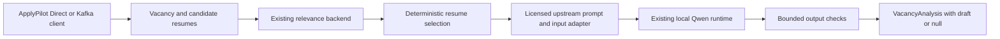

# Local cover-letter generation for ApplyPilot

Cover-letter generation is separate from relevance scoring. The new `analyze`
command scores each supplied resume, selects the highest-scoring positive match,
and asks one local Qwen generator for a plain-text draft. Exact ties preserve input
order. A rejected relevance decision never triggers generation. A generation
failure preserves the relevance result and returns `cover_letter: null`.

The [six-project source audit](cover_letter_audit.md) documents the old dependency
graph and reuse decision. No cover-letter implementation existed to remove:
the old schema reserved None-only slots. Qwen relevance generation, both matching
backends, extraction, checkpoints and their dependencies remain in use.



The generator adapts ApplyKit's MIT-licensed cover-letter prompt, JSON boundary
helpers and input builder. It reuses the project's pinned Qwen downloader and
`TransformersGenerator`; there is no new model training or generative framework.
The upstream database, UI, PDF and cloud-provider layers are excluded. The
Resume-Matcher Apache-2.0 prompt is retained as a comparison artifact, not a second
production generator. See `THIRD_PARTY_NOTICES.md` for exact source revisions,
modifications and complete original licenses.

## Local setup and invocation

Run from the checkout root:

```bash
uv sync --frozen --extra dev --extra data --extra qwen
source .venv/bin/activate
resumeanalysis download-e5 --output artifacts/e5
resumeanalysis-qwen download --config configs/cover_letter_qwen_cpu.json
HF_HUB_OFFLINE=1 TRANSFORMERS_OFFLINE=1 \
  resumeanalysis --threads 2 analyze --input examples/cover_letter_request.json \
  --qwen-config configs/cover_letter_qwen_cpu.json
```

The cover-letter configuration pins Qwen3-4B-Instruct-2507 revision
`cdbee75f17c01a7cc42f958dc650907174af0554`, CPU, unquantized bfloat16, greedy decoding,
4,096 input tokens and a 512-token output budget. `float32` remains the portable
explicit CPU alternative; numerical results and runtime can differ by dtype.
There is no automatic model, device or provider fallback. All comparisons within
a model use identical decoding parameters. The initial smaller-model diagnostic
has its own preserved configuration and is not the default.

Existing Qwen2.5-7B relevance configuration remains available. The new CPU dtype
option does not change its settings. Downloads require network access; inference
verifies local checksums, disables remote code, loads safetensors, and uses local
files only. Large weights remain outside Git.

The [example request](../examples/cover_letter_request.json) was executed offline
with the saved MLP and local Qwen. Its [actual result](../examples/cover_letter_result.json)
selects resume 1 with relevance 1.0 and a nonempty draft. That score describes
vacancy relevance, not the letter's factual accuracy. The draft itself still
elaborates on the import/check workflow beyond the source and needs review.

`--relevance-backend mlp` is the default and uses the existing checkpoint.
`--relevance-backend rerank --rerank-config configs/rerank.json` selects the
experimental matcher without changing the generator. Its assets must first be
downloaded explicitly. `--max-words` controls the final draft limit, default 180.

Inputs contain `vacancy`, a list of `{id, profile}` resume objects, `language`
(`en` or `ru`) and optional factual `candidate_context`. IDs must be unique and
positive. The existing profile fields retain their meanings: denied skills are
not abilities, absent information is unknown, and a vacancy requirement is not
candidate evidence. A title-only vacancy can support a restrained draft; an empty
vacancy or empty candidate facts cannot.

## Python and transport interfaces

```python
import asyncio
from pathlib import Path

from resumeanalysis.cover_letters.generator import LocalCoverLetterGenerator
from resumeanalysis.cover_letters.schema import AnalysisRequest
from resumeanalysis.cover_letters.service import AnalysisService
from resumeanalysis.embeddings.encoder import TextEncoder
from resumeanalysis.inference.backends import create_predictor
from resumeanalysis.qwen.cli import read_config

request = AnalysisRequest.model_validate_json(
    Path("examples/cover_letter_request.json").read_text(), strict=True
)
service = AnalysisService(
    create_predictor("mlp", encoder=TextEncoder("artifacts/e5")),
    LocalCoverLetterGenerator(read_config("configs/cover_letter_qwen_cpu.json")),
)
result = asyncio.run(service.analyze(request))
print(result.model_dump())
```

`DirectInferenceClient(service, resume_provider, language=..., context=...)`
implements the existing `process(vacancy) -> VacancyAnalysis` contract. A provider
implements `get_resumes() -> list[Resume]`. The earlier `LocalInferenceClient`
continues to provide relevance-only behavior.

`KafkaInferenceClient` uses the same resume provider and request schema through
`KafkaRequestReplyTransport`, which wraps already-started async producer/consumer
objects, such as ApplyPilot's aiokafka clients. `ModelWorker.handle(envelope)` calls
the same `AnalysisService`. `KafkaWorkerAdapter.run()` consumes requests, publishes
replies to a fixed configured topic and commits after publishing. Request IDs are
checked on replies. Worker error envelopes omit private input and model output.

Broker lifecycle, authentication, topics and a dedicated reply consumer/group are
configured by ApplyPilot. Use an exclusive request consumer with auto-commit
disabled. The adapter processes one request at a time; delivery is at least once,
so application-side deduplication remains necessary. No broker dependency is
required for Direct inference. Tests verify the wire contract and publish-before-
commit ordering with injected clients; no live Kafka broker was exercised.

## Draft safeguards and limits

The upstream prompt is adapted to explicit EN/RU output, short paragraphs, data-only
context, and source-backed claims. The initial validation exposed invented outcomes
under the upstream STAR instruction; the adaptation removes that requirement when
the source provides no result. This correction is selected using validation cases.

The output checks reject empty/oversized text, placeholders, analysis markup,
unexpected script mixing, unsupported digit-based numbers and recognized skills
that are absent or contradicted in candidate facts. These are bounded screening
checks, **not semantic proof that every sentence is true**. They can miss
unquantified embellishments, role/achievement claims and out-of-vocabulary skills;
lexical ambiguity can also reject a legitimate draft. User review is required.
No letter is automatically emailed or submitted by this subsystem.

The public result retains existing skill/evidence fields. `summary` and
`cover_letter` now accept optional strings, and `resume_id` an optional positive
integer. Existing relevance-only callers continue to receive None for these
fields. The selected resume ID is returned even when a letter is withheld.

The [measured comparison](cover_letter_benchmarks.md) separates automatic flags,
model outputs and qualitative review. Mock tests are not writing-quality evidence.
The authored set is small and not representative of hiring outcomes. No old
cover-letter baseline, independent human quality score or hallucination-free claim
is invented. Actual final outputs still contain unsupported elaborations, so the
strict source-factuality criterion remains unmet. This integration is a draft for
review, not an unattended application-submission release.

See the [validation record](cover_letter_validation.md) for executed checks,
the change inventory and deployment work that was not exercised.
