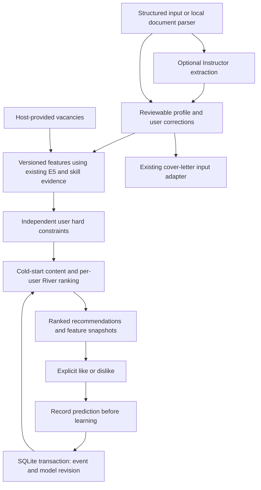

# Local online job recommendations

ResumeAnalysis now has a recommendation API that starts with no personalized
training data and learns from explicit likes/dislikes through River. Frozen E5
and existing qualification evidence are reused. The new `recommend` command does
not load an MLP checkpoint. Existing `predict`, `rank` and cover-letter `analyze`
commands remain available as separate legacy/experimental functions.



The [migration/source audit](online_recommender_migration.md) records the reused
modules and actual ApplyPilot branches. The [integration guide](online_recommender_integration.md)
defines host contracts. The [benchmark report](online_recommender_benchmarks.md)
separates synthetic behavior from real recommendation quality, which has not yet
been demonstrated.

## Setup and a persistent CLI example

```bash
uv sync --frozen --extra dev --extra data --extra qwen --extra profile-llm --extra documents
source .venv/bin/activate
resumeanalysis download-e5 --output artifacts/e5

HF_HUB_OFFLINE=1 TRANSFORMERS_OFFLINE=1 resumeanalysis recommend \
  --profile examples/recommendation_profile.json \
  --vacancies examples/recommendation_vacancies.json \
  --database artifacts/my-preferences.sqlite --exploration-fraction 0

resumeanalysis feedback --database artifacts/my-preferences.sqlite \
  --user-id demo-user --vacancy-id authored:data-remote --action dislike \
  --event-id my-feedback-1

# A new process restores learned state and excludes the rejected vacancy.
HF_HUB_OFFLINE=1 TRANSFORMERS_OFFLINE=1 resumeanalysis recommend \
  --profile examples/recommendation_profile.json \
  --vacancies examples/recommendation_vacancies.json \
  --database artifacts/my-preferences.sqlite --exploration-fraction 0

resumeanalysis preferences metrics --database artifacts/my-preferences.sqlite --user-id demo-user
```

The download is explicit; subsequent E5 inference loads local files only. No
personalized checkpoint, cloud service or message broker is needed. PDF/DOCX and
LLM extraction extras can be omitted when the host supplies structured profiles.
`--smoke-lexical` is an explicit diagnostic option, never an E5 fallback.

The [archived actual CLI demonstration](../evaluation/online_recommendations/cli_demo.json)
used separate processes and local E5. It began with preference scores of 0.5;
after one dislike and restart, that vacancy was suppressed and the other interest
scores were approximately 0.49375. One label mainly changes the intercept; it
does not establish that the model has learned a useful general preference.

## Python API

```python
from resumeanalysis.embeddings.encoder import TextEncoder
from resumeanalysis.recommendation.engine import RecommendationEngine
from resumeanalysis.recommendation.features import PreferenceFeatureBuilder
from resumeanalysis.recommendation.repository import SQLiteFeedbackRepository
from resumeanalysis.recommendation.schema import StructuredProfile, StructuredVacancy

repository = SQLiteFeedbackRepository("artifacts/preferences.sqlite")
engine = RecommendationEngine(PreferenceFeatureBuilder(TextEncoder("artifacts/e5")), repository)
profile = StructuredProfile(user_id="alice", facts={"skills": ["Python"]})
vacancies = [StructuredVacancy(vacancy_id="source:123", facts={"description": "Python work"})]
recommendations = engine.recommend("alice", profile, vacancies, limit=20)
shown = recommendations[0]
event = engine.record_feedback(
    "alice",
    shown.vacancy_id,
    "like",
    event_id="client-generated-unique-id",
    recommendation_id=shown.recommendation_id,
)
repository.close()
```

An application should pass the returned recommendation ID when recording delayed
feedback, so learning uses precisely the displayed feature snapshot. The simpler
call without that ID uses the latest snapshot for that user/vacancy. Unseen
vacancies and other users' snapshots cannot be labeled through this API.

## Features and ranking semantics

`StructuredProfile`, `StructuredVacancy`, `Recommendation` and `FeedbackEvent` each
have an explicit v1 schema. Feature identity includes schema version, encoder
identity/dimension, extractor/taxonomy identity and projection/hash settings.
The default has **47 compact numeric features**; the experimental variant adds
16 projected E5 coordinates and an availability flag for **64 total**.

Features include confirmed/unknown/denied required and optional skill coverage,
related-skill support, semantic similarity, explicit experience comparison,
salary/remote/location compatibility and preferred-role similarity. Independent
vacancy remote status and fixed eight-bucket signed hashes for role/location allow
feedback to discover preferences the user has never stated. Hashing is bounded
but can collide; it is not an exact semantic equivalence relation.

The enhanced representation uses scikit-learn's fixed GaussianRandomProjection,
seed 42, on the existing E5 vacancy vector. It learns no projection from labels
and never feeds all 384 embedding coordinates into River. Both variants share the
same scalar semantic similarity. The larger variant remains experimental because
the small synthetic comparison has mixed results and no real feedback validation.

Unknown values carry availability indicators. Unknown salary units/currency or
gross/net basis are not converted, unknown experience is not zero years, and
unmentioned skills remain unconfirmed. Skill-specific durations are preserved but
never summed into overall career duration. Qualification evidence does not use
likes/dislikes; a rejection cannot become evidence of professional incapacity.

User hard constraints reuse existing remote/location checks and add conservative
salary comparisons. Known conflicts are excluded before ranking or exploration.
Unknown constraints are returned with `status: unknown` by default, not called
incompatible; set `include_unknown_constraints=False` for a confirmation-first
host policy. Qualification gaps remain in their separate evidence summary.

Cold-start ranking uses available qualification evidence and explicit preferences;
with no usable information it is neutral (0.5), with stable vacancy-ID ties.
The qualification summary is a transparent heuristic, not a validated MLP score
or hiring probability. River's score is an **uncalibrated interest score**. Its
ranking weight increases over the first ten feedback events to a default maximum
of 0.7; hard constraints remain independent.

The default exploration fraction is 0.1: when there are more candidates than slots,
at least one slot samples the remaining eligible pool using a deterministic hash
of seed, user, model revision and vacancy ID. This rotates after feedback updates;
it stays stable between identical requests. Exploration never reintroduces a
rejected or blocked vacancy. It is a simple sampling policy, not a contextual bandit.

## Persistence, corrections and preference change

SQLite WAL transactions serialize event writes and model-revision changes across
app instances. The cache is published only after commit and checked against the
stored revision. Injected commit failures and concurrent app instances are tested.
The model's durable state is its configuration, reset boundary and immutable
feature/label history; River is restored through deterministic public-API replay.
No untrusted pickle or private River-attribute restore is used.

Each event records user/vacancy/event IDs, action, reason, UTC receipt timestamp,
profile/feature/model versions, the exact feature snapshot, the score at display
and the prediction immediately before updating. Transaction sequence defines
arrival order for delayed feedback. Viewing, ignoring, applying and interview
events do not automatically train negative or positive preference labels.

An event ID retry returns the original event; reusing the ID with a different
payload fails. A vacancy has one active explicit label. Repeating that label is
idempotent, while changing it requires `corrects_event_id`. Corrections append a
new event and replay effective history, removing the superseded label from model
updates rather than training on both labels. Historical pre-update predictions
remain immutable; reported online metrics use those recorded predictions, not
predictions recomputed after seeing future corrections.

```python
engine.record_feedback(
    "alice",
    "source:123",
    "dislike",
    reason="Preference changed",
    event_id="correction-2",
    corrects_event_id=event.event_id,
)
engine.reset("alice")  # Keep history and rejection suppression.
engine.replay("alice")  # Replay only feedback after the reset.
engine.replay("alice", include_before_reset=True)  # Explicitly restore earlier history.
```

Constant-rate River SGD and a configurable recent-history window respond to
changing preferences. The default window is 512 active events. Updates are
incremental until eviction; corrections and window eviction rebuild from the
bounded active window. The disclosed drift benchmark uses a smaller 32-event
window for a short scenario. Configuration or feature-identity mismatch fails
explicitly; it does not silently reuse an incompatible model. A new configuration
currently needs a new database or a deliberate migration.

## Profile extraction and document handling

`LocalDocumentParser` parses UTF-8 TXT, text-bearing PDF using pypdf, and DOCX
paragraphs/tables using python-docx. It checks byte, extracted-character, PDF-page
and DOCX expansion limits and retains original byte digests and PDF page offsets.
Malformed, encrypted, unsupported and image-only documents fail explicitly.
OCR, advanced layout, headers/footnotes and full document-fidelity reconstruction
are outside this MVP. The parser is replaceable through `DocumentParser`.

Instructor is optional. The default configuration points at local Ollama's
OpenAI-compatible endpoint and a user-installed `qwen2.5:7b` model. A compatible
local server/model must be provisioned explicitly; no automatic model download or
paid API fallback exists. Pin and record the deployed model digest. Remote URLs
require explicit `allow_remote=true`. The default transport disables environment
proxies and redirects; provider diagnostic details are suppressed during private
profile calls and public extraction errors omit document/model content.

```bash
resumeanalysis profile parse --input my-resume.pdf --output artifacts/document.json
resumeanalysis profile extract --input my-resume.pdf --user-id alice \
  --llm-config configs/profile_extraction.json --output artifacts/profile-draft.json
resumeanalysis profile confirm --input artifacts/profile-draft.json \
  --output artifacts/profile-confirmed.json
```

Extraction covers facts, skill-specific experience, education, projects, preferred
roles, salary units, work/location preferences and explicit hard constraints.
Every populated extracted attribute needs a literal source reference. Citations
prove where text came from, not entailment; LLM profiles remain `needs_review`
and cannot rank jobs until confirmed. Source budgets fail rather than truncate.
No live Ollama extraction quality was measured; tests exercise Instructor against
mocked local-provider responses and explicit invalid-output cases.

For structured input, use `StructuredProfileExtractor.from_structured` or the
`profile structured` CLI; no LLM is called. To edit a profile, supply a JSON object
mapping paths such as `/facts/experience_years` or `/preferences/remote` to new
values, then run `profile edit --input ... --changes ... --output ... --confirm`.
Edits create a new version and user-edit evidence while preserving original
documents. Existing output files are not overwritten. Host providers own profile
storage; the feedback database records immutable profile fingerprints and versions.

## Scope and limits

The implementation is local-first and imports maintained libraries rather than
reimplementing optimization or document formats. See the dependency inventory and
`THIRD_PARTY_NOTICES.md` for exact versions and complete original notices.
Existing matching checkpoints, extraction code, datasets and cover-letter assets
are preserved. Cover-letter factuality limitations from PR #8 remain unchanged.

Real preference improvement, probability calibration, live ApplyPilot deployment,
live Ollama extraction, scanned-document OCR and large-history load behavior are
not established. SQLite is a single-writer MVP. Histories and recommendation
snapshots are retained, and history reads currently grow with total events even
though training uses a bounded window. Retention/compaction, model migrations and
more efficient history indexing are follow-up work. Files are local, not encrypted
by this library; the host must enforce authenticated user identity and filesystem
access. Learned state is isolated by user, not by an invented authentication layer.
