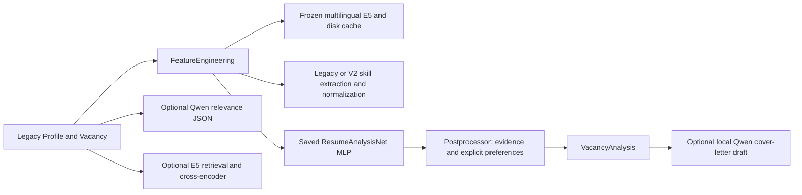

# Online recommendation migration plan

Source review: 2026-10-27, before implementation. Base:
`f31f48a` on `feature/local-cover-letter-generator`, whose tree equals `6b8c803`.
PR #9 merged main into that feature branch; this task does not merge into main.
Open draft PRs #4, #5, #7 and #8 retain their separate scopes.

## Current architecture and reuse

`embeddings/encoder.py` supplies the existing 384-dimensional frozen E5, local-only
loading, chunking and cache. Extraction/normalization provide known, denied,
unknown and alternative skill evidence. Feature serializers, taxonomy relations,
the conservative evidence builder and remote/location checks are reusable.
The MLP, checkpoint guards, training/data tools and historical tests remain a
qualification baseline, not a preference-learning model. Qwen relevance and
cover-letter generation remain separate from recommendation learning.

New code will use additive versioned schemas and a separate recommendation API;
existing `predict`, `rank`, `analyze`, `InferenceClient` and checkpoint formats
stay compatible. No skill vocabulary, training data or saved matching model is
changed. The new recommendation entry point uses River rather than an MLP.

## ApplyPilot findings

Inspected `zvictor12/pet_proj` main at
`65d400cd4a1851e98f3c19dc44b391c444147447`. Actual code and migration define
`mails` and `links`, with link fields `id`, `mail_id`, `url`, `domain`, `vacancy_id`.
The parser returns `VacancyLink(url, source_domain, vacancy_id)`. Only a health
route is registered. There is no structured vacancy content, candidate profile,
feedback table, recommendation route or implemented InferenceClient in this
revision. README architecture claims are not an implemented integration.

Use `(domain, vacancy_id)` as the external identity, with an explicit host-supplied
content resolver. Define profile/vacancy providers and a local recommendation
adapter, plus an explicit conversion to the existing cover-letter request. Do not
copy ApplyPilot implementation code: its repository declares no license. Do not
modify its repository, database or endpoints.

## Implementation sequence

1. Add strict profile/vacancy/recommendation/evidence schemas and versioned feature
   snapshots. Separate qualification evidence, user hard constraints and preferences.
   Preserve unknowns; compare compact features with a fixed 16-component projection
   of the existing E5 representation rather than feeding all coordinates directly.
2. Use River LogisticRegression and online scaling per user, starting empty.
   SQLite transactions persist recommendation snapshots, immutable feedback events,
   model configuration/revision and reset boundaries. Restore state by deterministic
   event replay; do not load arbitrary pickle files. Deduplicate retries, make
   corrections explicit and retain predictions taken before learning. Use a bounded
   recent-event window and constant learning rate to respond to preference changes.
3. Add Instructor extraction via an explicitly configured local compatible endpoint,
   literal evidence checks, reviewable extracted profiles and versioned user edits.
   Keep document parsing separate. Use pypdf and python-docx behind a replaceable
   TXT/PDF/DOCX parser with size/format/error handling; no automatic OCR downloads.
4. Implement cold-start content ranking, independent hard gates, rejected-vacancy
   suppression and deterministic configurable exploration. Add local adapters,
   CLI/demo, chronological prequential comparison and CPU time/memory measurements.
   Run new and existing tests, record dependency licenses, and open a draft PR.

## Upstream implementation review

- River `950984786649806bfdc446062fcc830235f8131b`: public LogisticRegression
  `predict_proba_one`/`learn_one`, SGD, online StandardScaler and pipeline update
  semantics. Prediction must not fit preprocessing; metrics precede label updates.
  BSD-3-Clause. Install the released 0.26.1 API and verify its installed source too.
- Instructor `6cd771c5254a69f6a6cf9cdf357fb2f9523f0b85`: OpenAI-compatible client
  wrapper, Pydantic output validation, retry behavior and Ollama documentation.
  MIT. Install released 1.17.0; do not copy provider code or require paid services.
- Unstructured `53a56a0aa18f721d902817f13779cb57b0251944`: TXT/DOCX/PDF partition
  implementations and dependencies inspected. Apache-2.0. PDF adds OCR/layout,
  inference, conversion and image dependencies; base includes spaCy and a service
  client. For text-bearing MVP documents, smaller format-specific parsers suffice.
  Scanned PDF/OCR and advanced layout remain explicit follow-up work.

No real preference history is available. Synthetic fixtures can establish
functionality, isolation, replay and adaptation, not real recommendation quality
or calibrated probabilities. Qualification scores and preference scores must be
labeled separately. Profile extraction citations establish source location, not
semantic truth; LLM drafts require confirmation before ranking.
