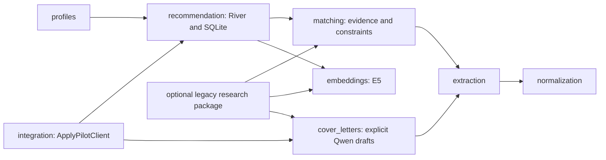

# Runtime package refactor

Base: `52bd68f` (the merged online recommender). Work is isolated on
`feature/runtime-cleanup`; main is not modified.

## Dependency findings and plan

The package root currently imports the MLP predictor. Recommendation features
import `rerank.evidence`, which imports the Qwen classification module only to
reuse skill evidence. The root CLI registers training, dataset preparation,
experiments and three matching backends. Cover-letter analysis selects between
MLP and cross-encoder scoring, while integration exposes multiple local/Kafka
clients. These are implementation couplings rather than requirements of the
River recommendation product.

1. Extract shared text serialization, skill evidence and constraint checks into
   `matching/`, preserving recommendation feature values and behavior.
2. Move training, dataset preparation, evaluation experiments, MLP/Qwen/cross-encoder
   matching and historical transport adapters to an optional `legacy/` distribution
   with the `resumeanalysis_legacy` namespace. Keep its regression tests runnable.
3. Retain the existing E5 implementation and local Qwen generation runtime. Keep
   Instructor profile extraction local by default. Production commands focus on
   recommendations, explicit feedback, profiles and drafting a letter for a selected
   vacancy; generation does not classify qualification or apply for a job.
4. Expose one local `ApplyPilotClient`, composing profile/vacancy providers, the
   recommendation engine and an optional letter generator. No transport layer is
   needed inside this package.
5. Update installation, packaging and current documentation. Verify the runtime
   wheel without installing legacy, and run both runtime and archived tests.

Before edits, authored examples were evaluated into
`tests/fixtures/runtime_refactor_baseline.json`. These preserve exact compact and
projected features, identities, qualification evidence and constraint outcomes.
Source-based extractor identities need a narrow, hash-verified compatibility map
when moving the training-only lexicon builder: unchanged inference must not reset
saved user models. Any unrecognized source change must still change the identity.

Saved checkpoints, model weights, historical evaluation artifacts, original
copyright notices and licenses are preserved. New paths and commands will be
documented; historical reports retain their original provenance and results.

## Delivered boundaries

The runtime contains exactly the eight product packages in the requested layout,
plus common schemas, JSON/checksum helpers and the CLI. The default distribution
is version 0.2.0 because historical imports/commands move to an explicit namespace.
Its wheel does not contain `data`, `training`, `models`, `experiments`, `inference`,
`rerank`, a separate Qwen classifier package, or Kafka adapters.

`resumeanalysis_legacy` depends on the runtime, never the reverse. It is installed
only with `uv sync --group research`. Historical tests run separately. PyArrow and
structured classification's format-enforcer dependency belong to this group;
there are no third-party version upgrades in the refactor. The normal cloud setup
downloads E5 explicitly and demonstrates recommendations without fitting an MLP.

`matching.evidence.SkillEvidence` contains qualification evidence without MLP
embedding/vector fields. The archive retains its original `FeatureDetail` and
feature engineering. The Qwen classification predictor imports shared skill
evidence instead of being imported by it. Qualification scores, preference
features, unknownness, ranking weights and SQLite schema/version remain unchanged.
Legacy score postprocessing also stays in the archive; runtime constraint checks
call a small shared function directly, without constructing a classifier result.

The shared `GenerationConfig` describes local model generation and defaults to CPU
without quantization. Classification-specific thresholds/retries remain in the
archived `QwenConfig`, preserving its former defaults. The runtime's explicit
cover-letter configuration keeps its existing model, revision and generation
settings; the unused classification retry field is removed. Its original complete
configuration is retained in `legacy/configs/cover_letter_qwen_cpu.json`.

The root API now exports recommendation/profile types. The root CLI offers
`recommend`, `feedback`, `preferences`, `profile`, `extract`, `cover-letter`,
`download-e5` and `download-qwen`. Research commands use `resumeanalysis-legacy`.
The old `analyze` workflow still runs in the archive. The new `cover-letter` command
accepts one selected profile/vacancy and does not gate generation on a legacy model
score. Letters remain drafts; no application or message is sent.

## Saved-state compatibility

Inference portions of the phrase loader are unchanged, but removing its training
function changes source-file hashes. `extraction/identity_compatibility.json`
records the complete previous and refactored source sets. The compatibility helper
uses the previous source identity only for this exact reviewed set, including the
helper itself. Any subsequent edit to those inference files produces a new identity.
The normalizer, vocabulary, lexicon-content and taxonomy inputs still participate
in the identity. Tests verify both equality to pre-refactor feature snapshots and
identity changes after an unrecognized source edit.

No database rewrite or blanket identity bypass is introduced. A saved feedback
database from the previous version was opened with both versions using actual E5;
recommendations, qualification evidence and preference scores were identical.
See [executed validation](runtime_validation.md) and the
[legacy migration table](../legacy/README.md) for paths and commands.
